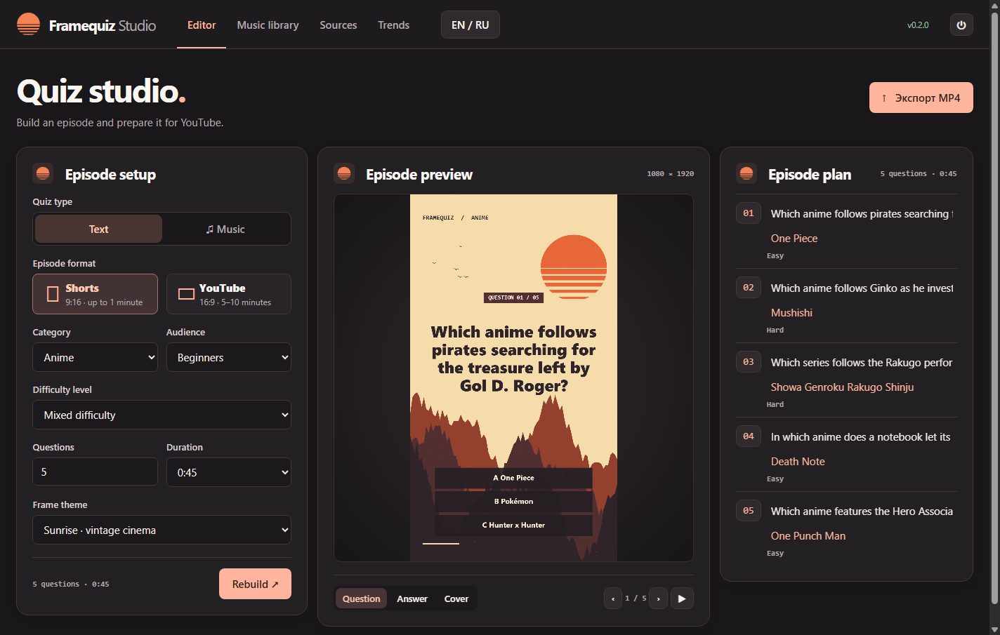
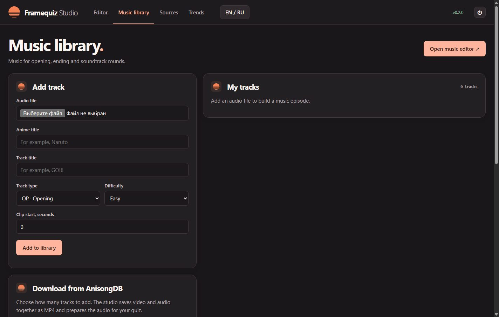

# Framequiz Studio

[Русская версия](README.ru.md) · [Download for Windows](https://github.com/Rub1nchik702/framequiz/releases/latest)

Framequiz Studio turns anime openings, endings and trivia questions into timed quiz videos for YouTube and Shorts. Choose tracks by difficulty, trim the clips, design a cover and export an MP4 on your Windows PC.

## What's new in 2.5.0

- Browse Shikimori by genre, year and format, find openings and endings, and collect songs across titles in the basket.
- Arrange rounds on the board, adjust the Shorts or YouTube timeline, and preview the Pop or Solar design.
- Check difficulty with AMQ exports, retry failed downloads, and export your quiz as MP4.

## First episode

1. Extract the entire Windows ZIP into a writable folder and run **Framequiz.exe**. The desktop window uses Microsoft Edge WebView2 Runtime. Choose **EN / RU** in the header to switch languages.
2. In **Music library**, import local audio or choose an opening or ending from AnisongDB. The studio stores the video, song title and anime title together. Difficulty comes from the catalog or from a matching AMQ Song List UI export.
3. In the music editor, set the number of easy, medium and hard tracks for each type. Build the plan, adjust the start of each clip, preview and export. Finished episodes appear in the **exports** folder.
4. For a text episode, select a topic and audience. The Sources tab accepts individual questions, a UTF-8 JSON question list, or RSS and Atom feeds for research.

## Updates from this private repository

Accept the repository invitation using your own GitHub account. In Framequiz **0.2.4**, click the version in the header and choose **Update → Sign in with GitHub**. Enter the displayed code on GitHub in your browser and authorize Framequiz Desktop Updates 702. Return to the updater and click **Update**. It downloads **2.5.0**, verifies SHA-256, installs the program files and reopens the studio. The existing `tracks` and `exports` stay in the installation folder. The access token is protected for your Windows user with DPAPI. Use **Sign out** to remove it, or sign in again when the session expires.

In 0.2.4 the first button in the updater may still say **Sign in with GitHub** when you already have a saved session. Click it once to continue using that session.

**Upgrading from 0.2.1 without GitHub CLI:** download **Framequiz-Update.exe** from Releases, exit the old studio via its tray menu, and double-click the updater. Select the existing Framequiz.exe when prompted. Your tracks, exported videos and drafts are kept.

To publish the next release, update the package version in **Cargo.toml** and its matching entry in **Cargo.lock**, push both files to `main` to trigger **Publish Windows release**. The job builds the code, reuses the packaged FFmpeg from the previous release and publishes a new version tag and ZIP. User media, exports and WebView2 drafts are stored separately.

Click the version in the header for live update status. A per-launch session protects local API and audio requests. The studio runs at most two FFmpeg jobs at once.

Already installed 3.0.0? Close it from the tray and extract the [2.5.0 ZIP](https://github.com/Rub1nchik702/framequiz/releases/tag/v2.5.0) over the same installation folder. The updater only installs higher version numbers.

## Development

Run `cargo build --release --locked` on Windows. To package, place ffmpeg.exe and FFmpeg-COPYING.txt in dist, unpack the Microsoft.Web.WebView2 NuGet SDK, and run `python tools/package.py --webview-sdk PATH_TO_SDK`. Use audio and video you have permission to publish. Open Trivia DB questions are licensed under [CC BY-SA 4.0](https://creativecommons.org/licenses/by-sa/4.0/). The Windows distribution includes the FFmpeg license.

