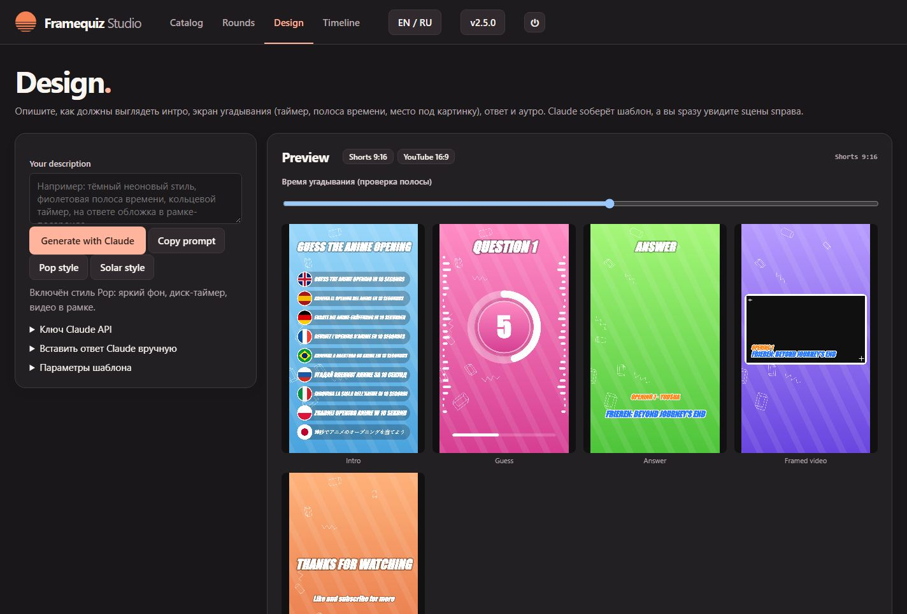
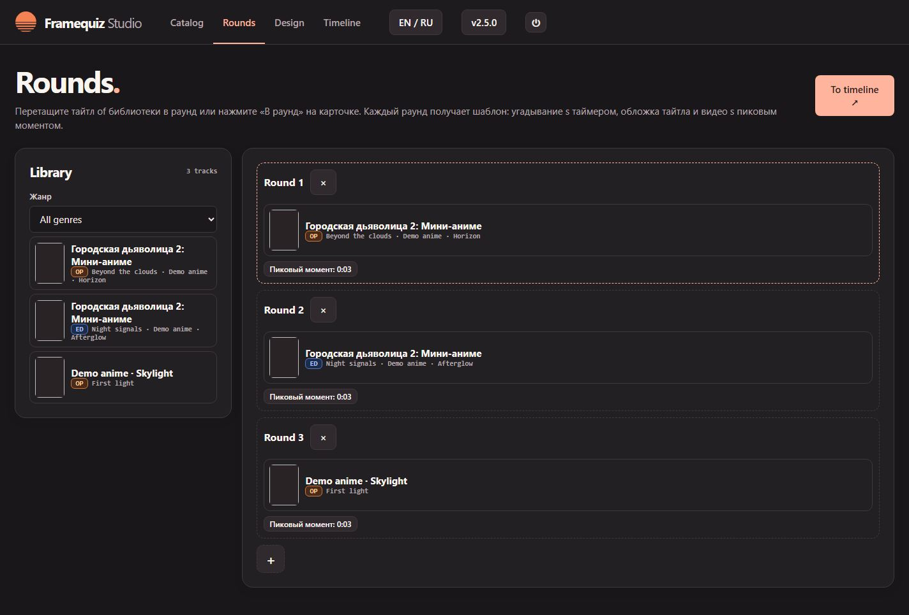
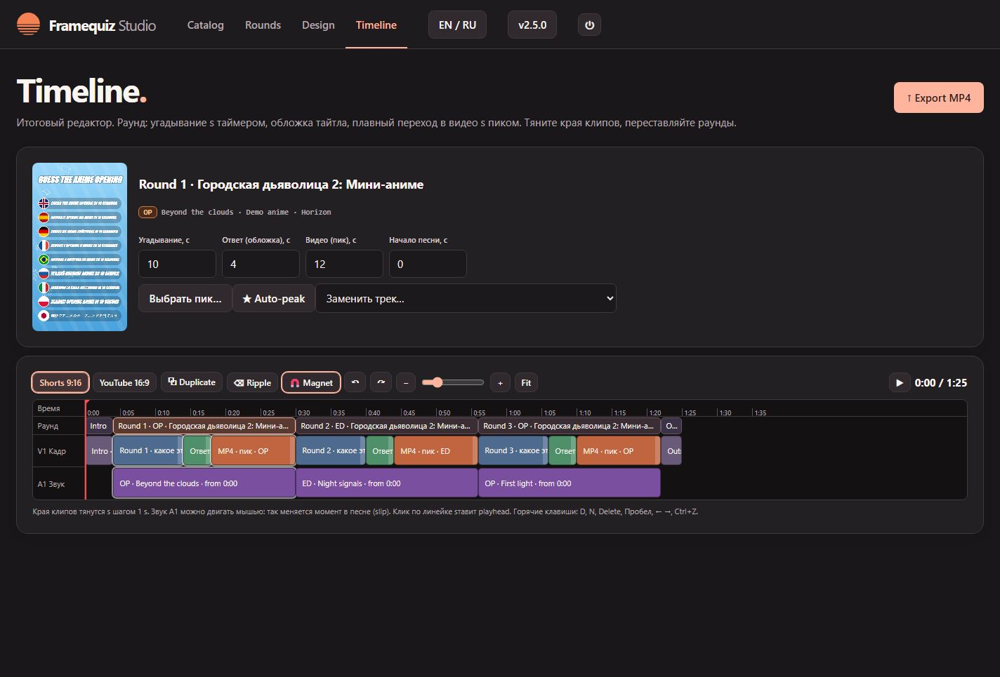

# Framequiz Studio

[English](README.md) · [Скачать для Windows](https://github.com/Rub1nchik702/framequiz/releases/latest)

Кнопка **EN / RU** в верхней панели переключает язык интерфейса.

## Что нового в 2.5.0

- **Каталог и корзина.** В Shikimori можно искать аниме по жанру, году и формату, фильтровать по сложности AMQ и скачивать опенинги и эндинги из разных тайтлов одной подборкой. У песен видны номера OP и ED.
- **Доска раундов.** Добавляйте треки из фонотеки, меняйте порядок раундов и выбирайте, с какого момента начать видео. Функция «Автопик» подсказывает точку начала.
- **Дизайн.** Стили Pop и Solar можно посмотреть на всех сценах выпуска — от интро и угадывания до ответа, видео в рамке и аутро. В предпросмотре можно изменить время на таймере и соотношение сторон.
- **Таймлайн и экспорт.** Настраивайте длительность угадывания, ответа и видеофрагмента для Shorts (9:16) и YouTube (16:9), обрезайте клипы и следите за ходом экспорта MP4.







## Обновления

Примите приглашение в закрытый репозиторий под своим аккаунтом. В версии **0.2.4** нажмите номер версии → **Обновить → Войти через GitHub**. Введите показанный код на странице GitHub, подтвердите вход, вернитесь в приложение и нажмите **Обновить**. Обновлятор скачает **2.5.0**, сверит SHA-256, установит файлы программы и снова откроет студию. Папки `tracks` и `exports` сохранятся. Windows защищает сохранённый токен через DPAPI. Кнопка **Выйти из аккаунта** удаляет его.

В 0.2.4 первая кнопка в окне обновлятора может показывать **Войти через GitHub**, даже если вход уже сохранён. Нажмите её, чтобы продолжить с сохранённым сеансом.

**Первый переход с 0.2.1 без консоли:** скачайте **Framequiz-Update.exe** из Releases, завершите старую студию через трей и запустите обновлятор. Выберите установленный Framequiz.exe. Фонотека, выпуски и черновики сохраняются.

Чтобы выпустить обновление, измените версию приложения в Cargo.toml и Cargo.lock, отправьте оба файла в `main`. Это автоматически запустит **Publish Windows release**.


Если уже установлена 3.0.0, закройте её через трей и распакуйте [ZIP версии 2.5.0](https://github.com/Rub1nchik702/framequiz/releases/tag/v2.5.0) поверх установки. Автообновлятор устанавливает только более высокие версии.

Локальная Windows-студия для англоязычных квизов. Распакуйте Windows ZIP и откройте **Framequiz.exe**. Рядом с программой должны находиться **ffmpeg.exe** и папка **window** из комплекта. Для встроенного окна нужен Microsoft Edge WebView2 Runtime.

Крестик окна и кнопка со стрелкой в верхней панели сворачивают студию в системный трей. Щелчок по полосатому солнцу возвращает окно. Правый щелчок открывает меню с командой **Выход**. Если Windows скрыла значок, раскройте список значков стрелкой рядом с часами. Аргумент командной строки --tray запускает студию сразу в трее.

Встроенное окно использует собственный профиль WebView2. Пункт **Открыть в браузере** возвращает доступ к черновикам предыдущей версии, если используется тот же профиль браузера. Фонотека и экспортированные видео хранятся рядом с приложением и доступны из обоих окон.

## Первый выпуск

1. Выберите Shorts (1080 × 1920, до минуты) или YouTube (1920 × 1080, 5–10 минут), тематику, сложность и шаблон. Для начинающих студия показывает варианты ответа, для знатоков оставляет открытый вопрос.
2. Задайте число вопросов и желаемую длительность. Внизу панели отображается итог с учётом целых секунд на раунд. Нажмите **Собрать план**. При нехватке уникальных вопросов выбранной сложности уменьшите количество или пополните каталог.
3. Отредактируйте английский текст и ответы прямо в плане. Счётчик и стрелки переключают раунды, кнопка воспроизведения показывает выпуск по таймеру.
4. Во вкладке **Обложка** укажите заголовок, при желании добавьте свою иллюстрацию и скачайте горизонтальную PNG-обложку 1920 × 1080.
5. Нажмите **Экспорт MP4**. Студия сохранит файл в **exports** рядом с программой. В ролике есть звуковые сигналы перед раскрытием ответа и в момент раскрытия. Хронометраж и соотношение сторон задаются в редакторе.

## Музыкальный выпуск

1. В **Фонотеке** выберите аудиофайл (MP3, WAV, FLAC, OGG или M4A, до 128 МБ). Введите название аниме и трека так, как они должны появиться в английском выпуске. Укажите тип OP, ED или OST, сложность и секунду начала отрывка. Фонотека хранится в папке **tracks** рядом с программой.
2. Нажмите **В музыкальный редактор**. В таблице задайте точное количество для каждой из девяти комбинаций типа и сложности. Под ячейкой указано число подходящих записей с учётом длины отрывка. Студия перемешивает треки без повтора одной записи.
3. Для Shorts выберите длину отрывка. Для большого выпуска выберите общую длительность, и студия рассчитает отрывки для выбранного числа раундов. Ответ занимает 4 секунды для начинающих или 3 секунды для знатоков. Итоговый хронометраж виден перед сборкой плана.
4. Соберите план, прослушайте выпуск кнопкой ▶ и нажмите **Экспорт MP4**. Сначала звучит отрывок без названия, затем появляются названия аниме и трека. Их можно поправить прямо в плане. На широком экране у вертикального ролика в режиме редактирования рядом видны оба кадра.


### Опенинги и эндинги из AnisongDB

В **Фонотека → Скачать из AnisongDB** задайте количество OP и ED по каждой сложности и нажмите **Скачать в фонотеку**. Видео со звуком сохраняется как «Аниме - Песня.mp4» в папке записи. Кнопка **Показать MP4** открывает файл в проводнике. Для выбора конкретного OP или ED нажмите **Показать список**, выберите песню, проверьте заполненную форму и нажмите **Скачать MP4 и добавить**. Музыка, названия аниме и песен сохраняются в папку tracks рядом с EXE. Для смешанного выпуска выберите AnisongDB в музыкальном редакторе, заполните обе строки таблицы и нажмите **Собрать план**. OST берутся из фонотеки.

Уровни определяются по проценту угадывания: от 70% — легко, от 40% до 70% исключительно — средне, ниже 40% — сложно. По умолчанию показан процент AnisongDB. Для сверки откройте в AMQ Song List UI список песен, нажмите Export и загрузите JSON в **Фонотека → Сверка сложности с AMQ**. Для совпавших записей студия использует процент из экспорта и показывает источник в карточке.

Готовые записи в ZIP не входят. Перед публикацией видео убедитесь, что у вас есть право использовать выбранные записи. Наличие аудио в каталоге не предоставляет лицензию на публикацию. [AnisongDB](https://anisongdb.com/) · [Справка YouTube](https://support.google.com/youtube/answer/2797449?hl=ru).

### Папка, отрывки и замена раунда

- В **Фонотеке** откройте **Импорт папки**. Студия покажет аудиофайлы из папки и подпапок. Проверьте названия и задайте общий тип и сложность. Имена вида «Аниме - Трек» заполняют оба поля автоматически. При частичной ошибке в списке останутся файлы, которые можно повторить.
- Нажмите **Отрывок** рядом с треком в фонотеке или плане. Выберите начало щелчком по звуковой дорожке или ползунком и проверьте выделение кнопкой **Прослушать**. В фонотеке сохраняется начальная отметка для следующих планов. Из плана можно изменить отметку только этого раунда.
- Нажмите **Заменить** рядом с раундом, чтобы выбрать свободный трек того же типа и уровня. Студия показывает только записи, в которых хватает аудио для текущей длительности.
## Источники и тренды

В каталоге 72 авторских текстовых вопроса. В разделе **Источники** можно добавить вопрос вручную, импортировать английские вопросы из Open Trivia Database, сохранить сайт-референс или прочитать RSS/Atom. У публикации из ленты нажмите **Взять за основу**, чтобы перенести ссылку в форму вопроса. Текст вопроса и ответ для такой публикации вводит редактор.

Для импорта готовых вопросов со своего сайта укажите HTTPS-адрес UTF-8 JSON-массива. За импорт принимается до 200 новых вопросов. Тематика берётся из формы, уровни сложности — easy, medium и hard.

```json
[
  {
    "question": "Which series follows pirate captain Monkey D. Luffy?",
    "answer": "One Piece",
    "difficulty": "easy"
  }
]
```

**Тренды** запрашивают у YouTube Data API v3 свежие видео по запросу «выбранный жанр + quiz», с предпочтением английского языка и выбранным регионом выдачи. Результаты отсортированы по просмотрам за выборку публикаций последних 30 дней. Это подборка популярных свежих роликов. Темп прироста просмотров студия не измеряет. Для поиска включите YouTube Data API v3 в своём Google Cloud проекте и введите его API-ключ. Ключ остаётся в памяти на время сеанса. Видео можно сохранить в референсы.

Импортированные вопросы Open Trivia DB распространяются под [CC BY-SA 4.0](https://creativecommons.org/licenses/by-sa/4.0/). В плане у импортированных вопросов есть ссылка на источник. При публикации такого материала укажите Open Trivia DB, ссылку на лицензию и сделанные изменения.

Нажмите номер версии в шапке, чтобы увидеть статус обновления. Для запросов к локальному API и аудио нужен ключ текущего сеанса. Одновременно выполняются не более двух заданий FFmpeg.

## Сборка

Нужны Rust с Cargo для Windows и FFmpeg с кодировщиками libx264 и AAC.

```powershell
cargo build --release --locked
```

Поместите ffmpeg.exe рядом с target/release/quiz-studio.exe. Rust обслуживает интерфейс на 127.0.0.1:39742, собирает план, загружает источники через системный curl.exe, создаёт звуковую дорожку и управляет кодированием. Редактор на HTML/CSS/JavaScript встроен в EXE. Он рисует по два кадра на раунд. FFmpeg разворачивает их в видео 24 fps. Для тестирования без открытия окна передайте программе --headless.

Комплектный FFmpeg 9.0.2 Essentials собран [Gyan](https://www.gyan.dev/ffmpeg/builds/) и поставляется через imageio-ffmpeg. Лицензия бинарной сборки — GPLv3, см. FFmpeg-COPYING.txt в комплекте. [Исходный код FFmpeg](https://github.com/FFmpeg/FFmpeg) и [скрипты сборки](https://github.com/GyanD/codexffmpeg).

